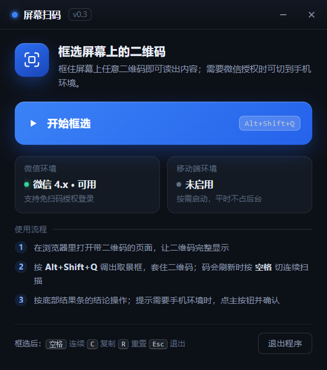

# 微信屏幕扫码（ScreenQR）

在电脑上**框选屏幕里的二维码**，直接把内容读出来 —— 不用掏手机拍照，也不上传到任何服务器。



主要用途：PC 微信里那些"要用手机扫"的登录/授权二维码，框一下就能拿到链接并用默认浏览器打开。
附带能力：手机端代理模式（让微信以为自己在手机环境）、搜一搜结果直达、连续扫码、自定义提示音。

## 免责与许可

- 许可证：[MIT](LICENSE)。可自由使用、修改、再分发，保留版权声明即可。
- 本工具会**模拟键盘/鼠标、修改系统代理、安装本地根证书**（仅在启用对应功能时）。
  完整行为清单见 [`SECURITY-行为说明.md`](SECURITY-行为说明.md)。
- **使用边界**：仅用于**你本人有权访问**的系统（自己的账号、已获授权的组织系统）。
  不要用于绕过访问控制、付费墙、他人账号或任何你无权访问的服务。
- 自动化操作微信客户端可能触及微信软件许可协议，请自行判断使用场景；
  与微信官方无关，也未获其授权。
- 启用「手机环境」会改写发往目标站的 UA。部分第三方系统按其服务条款限制
  非官方客户端的访问，是否使用请自行评估合规性。

## 系统要求

| 项目 | 要求 |
|---|---|
| 操作系统 | **Windows 10 1809 及以上 / Windows 11，x64** |
| 运行库 | 系统自带即可（PowerShell 5.1、.NET Framework 4.x） |
| 屏幕取词 | WinRT OCR，**需中文 OCR 语言包**（Win N 版可能缺媒体功能包） |
| 微信 | 需为 **4.x 中文版**；`微信` 相关功能才需要 |
| Python | **不需要**。内置 CPython 3.12 运行时随包分发 |

> Win7 / 8.1 不支持（Electron 31 的 Chromium 已放弃）。macOS / Linux 未适配：
> 核心能力依赖 Windows 的 UIA、GDI、WinRT 与注册表。

## 下载与安装

从 [Releases](../../releases) 下载 `ScreenQR-<版本>-x64.exe`（NSIS 安装包，约 88 MB，
其中 22 MB 是内置 Python 运行时）。

**这个包没有数字签名**，所以：

1. 首次运行会出现 **"Windows 已保护你的电脑"** → 点 **更多信息** → **仍要运行**。
   这是"没有代码签名"的通用提示，不是病毒警告；未签名程序每次都会提示。
2. 杀毒软件可能报警。本程序的行为（改代理、装根证书、模拟按键、动态编译）在启发式引擎里属高危。
   可加白名单，或按下文自行构建。

**核对下载是否完整 / 是否被替换**：

```bash
# 与 Release 页的 SHA256SUMS.txt 对比
certutil -hashfile ScreenQR-0.4.0-x64.exe SHA256

# 或用构建来源证明（需安装 GitHub CLI）
gh attestation verify ScreenQR-0.4.0-x64.exe --repo Huusser/pc-screen-qr-scanner
```

为什么不签名、什么时候才值得签，见 [`代码签名-新手实操指南.md`](代码签名-新手实操指南.md)。

## 从源码运行

```bash
git clone https://github.com/Huusser/pc-screen-qr-scanner.git
cd pc-screen-qr-scanner/desktop
npm ci
npm run runtime      # 下载内置 Python 运行时（约 22 MB，SHA-256 校验）
npm start            # 或双击 start.bat
```

打包安装包：

```bash
npm run prepare:builder   # 预热 electron-builder 缓存（换机器必跑，见 README）
npm run dist              # → dist/ScreenQR-<版本>-x64.exe
```

更详细的设置项、快捷键、定位方式、故障排查见 [`desktop/README.md`](desktop/README.md)。

## 目录结构

```
desktop/            Electron 主程序（窗口 / 取景框 / 热键 / 设置 / 托盘）
  main.js           主进程
  launcher.html     主界面与设置
  overlay.html      屏幕取景框
  wechat-auto.js    「交给微信」/ 搜一搜代点
  proxy-manager.js  「手机环境」代理的启动与还原
  paths.js          可写路径统一出口（数据在 %APPDATA%\ScreenQR）
  tools/            图标生成、运行时下载、打包准备、签名与复核
  build/            打包图标
proxy/              Python 侧本地代理（只依赖标准库 + 内置运行时）
  run_proxy.py      管理器：PAC / 管理接口 / 系统代理设置与还原
  mitm_proxy.py     代理本体：TLS 解密 + UA 改写
  certgen.py        纯 Python 签发本地 CA 与按域名证书（无需 openssl）
.github/workflows/  构建 → 校验和 → 来源证明 → 发布 Release
```

## 隐私

- 不联网、不上传、不读取聊天记录；二维码解码在本地完成。
- 代理日志**默认关闭**（设置 → 移动端 → 代理日志：关闭 / 仅域名 / 完整）。
- 根证书**首次启用手机环境时现场签发**，私钥只在本机 `%APPDATA%\ScreenQR\proxy\certs`，
  不随安装包分发。卸载时可一并移除。

## 开发与验证

```bash
npm run selftest                        # 开发态全量自检（显示/捕获/窗口/热键）
dist\win-unpacked\屏幕扫码.exe --envcheck  # 安装形态：确认内置运行时可用
dist\win-unpacked\屏幕扫码.exe --selftest  # 安装形态：全量自检
npm run verify:sign                     # 若自行签名，复核签名状态
```

安全行为清单见 [`SECURITY-行为说明.md`](SECURITY-行为说明.md)，
「手机环境」的触发与还原机制见 [`扫码登录-移动端代理触发机制.md`](扫码登录-移动端代理触发机制.md)，
发布与代码签名流程见 [`代码签名-新手实操指南.md`](代码签名-新手实操指南.md)。
变更记录见 [`CHANGELOG.md`](CHANGELOG.md)，安全问题怎么报见 [`SECURITY.md`](SECURITY.md)，
改代码前先看 [`CONTRIBUTING.md`](CONTRIBUTING.md)。

---

## 发布者须知

仓库地址按 **`Huusser/pc-screen-qr-scanner`** 预填（`package.json` 的 `repository` / 本文件里的
`clone`、`attestation` 命令均已对齐）。**该仓库尚未在 GitHub 上创建**，所以现在这些链接是 404，
建仓并推送后即生效。

首次发布三步：

**1. 在 GitHub 上创建空仓库**（不要勾选自动生成 README/License，否则首次 push 会冲突）

1. 仓库名：`pc-screen-qr-scanner`
2. 可见性：Public
3. 创建后执行：

```bash
git remote add origin https://github.com/Huusser/pc-screen-qr-scanner.git
git push -u origin main
```

> 若改用其他账号或仓库名，需要同步 4 处（本文件 2 处 + `desktop/package.json` 3 个 URL）：
> `grep -rn "Huusser/pc-screen-qr-scanner" README.md desktop/package.json`

**2. 先手动验证一次 CI，再打 tag 发布**

`.github/workflows/release.yml` 支持 `workflow_dispatch`：先在 Actions 页手动运行一次，
确认 `npm ci → npm run runtime → npm run dist` 全通、artifact 里有 exe 与 `SHA256SUMS.txt`；
确认无误后再：

```bash
git tag v0.4.0 && git push --tags     # 只有 tag 才触发 Release
```

**3. 发布后打开仓库设置**：Issues（配合 `CONTRIBUTING.md`）、Security advisories（配合 `SECURITY.md`）、
以及在 Release 说明里提醒"未签名 + 代理行为会被杀软误报"。

